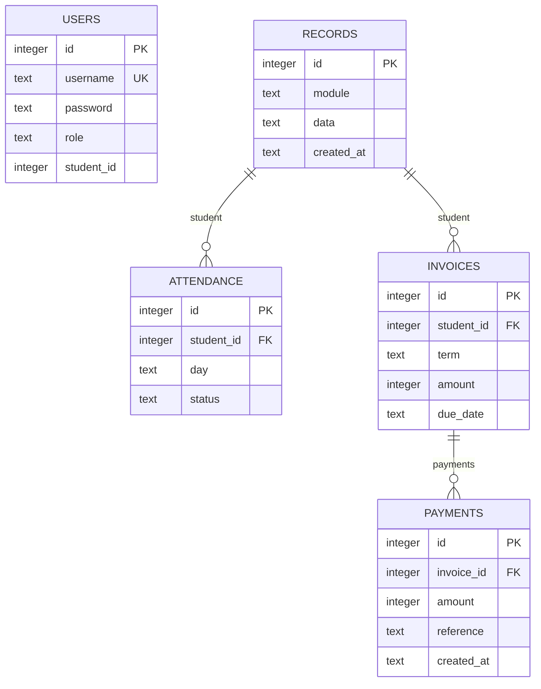

# API and data contracts

## Connected configuration APIs (version 2)

- Operational records now include curricula, country_profiles, and departments.
- `GET /api/accounts`: administrator-only account metadata; excludes password hashes.
- `POST /api/accounts`: administrator provisions/updates `{id?,username,role,password?,student_id?,staff_id?,department_id?,active}`. Students/parents need a valid student link; teachers need staff; department accounts need a department. Updates invalidate that account's sessions. New or reset passwords require 12 characters.
- `POST /api/checkin`: teacher/student only, body `{}`. Uses authenticated account and school date. Rejects user-supplied identity/date fields and is idempotent per user/date.
- `/api/data` additionally returns visible check-ins, school date, country-field schema for authorized student editors, and admin-visible role choices.
- Student writes accept a custom_fields object with string values. The active country profile validates required fields, dates, numbers, and allowed choices. Historical fields are retained.
- Settings additionally accept country, country_code, country_profile_id, and utc_offset_minutes. The selected profile's code must match the school country code.
- Login may specify portal; an account cannot authenticate into a portal with a different role.

Migration adds staff_id, department_id, and active columns to users, plus a checkins table with unique `(user_id,day)`. These links are checked by application logic; the self-check-in user reference is a SQL foreign key.

All API responses are JSON. Errors return `{"error":"message"}` with an appropriate 400/401/403/404/409/500 status. The frontend and backend are served from the same origin. Mutations require a session cookie and `X-CSRF-Token` from login or `/api/me`; login is exempt.

| Method / route | Contract |
| --- | --- |
| `POST /api/login` | `{username,password}` → account, role, linked student, CSRF token, session expiry; sets cookie |
| `GET /api/me` | Current account/session metadata |
| `POST /api/logout` | `{}` → invalidates session |
| `POST /api/password` | `{current,password}`; new password at least 12 characters |
| `GET /api/data` | Visible module arrays, attendance, invoices, payments, audit, school settings, readable modules, edit permissions |
| `POST /api/<module>` | Creates an allowlisted operational record; include `id` to update |
| `DELETE /api/<module>/<id>` | Deletes an operational record; linked students are protected |
| `POST /api/attendance` | `{day:"YYYY-MM-DD",entries:[{student_id:1,status:"Present"}]}`; upsert by student/day |
| `POST /api/invoices` | `{student_id,term,amount,due_date}`; amount integer minor units |
| `POST /api/payments` | `{invoice_id,amount,reference}`; positive integer minor units within balance |
| `POST /api/settings` | `{school_name,term,currency}`; administrator only |

Operational modules: students, staff, classes, timetable, events, notices, library, transport, boarding, health, conduct, grades. Field allowlists appear in `MODULES` in server.py and labels in public/app.js. The server ignores extra payload fields; updates replace all allowlisted fields.

Payments and invoices are append-only through the API. Attendance is updatable but not deletable through the UI. CSV, report-card, and receipt downloads are generated in the authenticated browser from server-filtered data; there is no public export endpoint.

## Database relationship outline

Guardian scope in users and the student references inside generic JSON records are checked in application logic. They are not SQL foreign-key columns. Attendance's unique key is `(student_id, day)`. Invoice balance is derived from invoice amount minus recorded payment sums; it is not stored separately.
