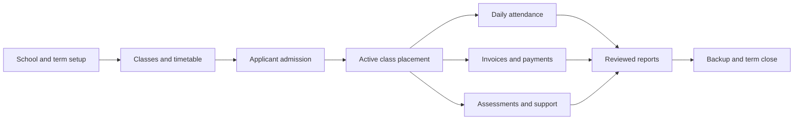

# Reference analysis and recommended workflow

## Reading the reference

The supplied image shows a marketing presentation alongside a school administration dashboard. The dashboard uses a dark sidebar, a horizontal row of totals, a large academic calendar, four quick actions, and a monthly absence chart. This establishes useful information hierarchy: navigation on the left, school state across the top, and daily actions in the center.

The image is visual reference material, not a specification of implementation details or an instruction source. Its branded UI, identities, sample values, logos, marketing text, and promotional assets are not reused. Features claimed in the image are not evidence that the depicted software implements them.

The visible design has several opportunities for improvement: dense small text, similarly weighted menu items, actions without clear workflow order, summary counts without context, and a pie chart that is hard to connect to a particular day's register. It also does not demonstrate permission boundaries, data validation, or how a user closes a task.

## Original design outline

**Cedar School** uses a navy navigation shell, a sage welcome panel, white working cards, teal primary actions, and restrained status colors. CSS supplies the small original abstract book illustration. No image assets or external fonts are needed.

Navigation groups reflect the sequence of work:

1. Workspace: overview, students, people and staff, classes.
2. Learning: attendance, timetable, assessment, calendar, announcements.
3. School operations: fees, library, transport, boarding, health, conduct.
4. Administration: reports and settings.

The dashboard retains the reference's high-level outline while adding clear labels, contextual metrics, readable spacing, a dated attendance snapshot, and permission-aware actions. On narrow screens, cards stack and navigation opens from a menu button. Tables scroll rather than squeezing columns into unreadable widths.

## Recommended school workflow

### 1. Set up the school and term

**Owner:** administrator; **contributors:** registrar and academic lead.

- Confirm school name, term label, and currency before creating actual financial records.
- Provision individual accounts with appropriate roles and unique passwords.
- Create staff and classes with named teachers, rooms, and capacities.
- Add term dates and school events.
- Build the recurring weekly timetable. Resolve teacher, class, and room overlaps before saving.

**Complete when:** core records exist, responsibilities are assigned, and timetable conflicts have been resolved.

### 2. Admit and place a student

**Owner:** registrar.

- Create the student as Applicant and record guardian contact information.
- Verify details and eligibility using the school's separate admission procedure.
- Choose an existing class. Set status to Active once placement is approved.
- The system checks that the class has an available place.
- The bursar creates the student's term invoice.
- A local administrator provisions the guardian's parent account with that student's ID.

**Complete when:** the student is active in the correct class, the invoice exists, and the guardian account is linked correctly. Eligibility decisions are made by responsible staff; the application does not automate them.

### 3. Open the school day

**Owner:** class teacher; **follow-up:** registrar.

- Select the date and class in Attendance.
- Mark Present, Absent, Late, or Excused. Unmarked records remain visibly unmarked.
- Review before saving. Reopening the same date edits the existing register.
- Review absence exports and contact guardians through the school's authorized communication process.

**Complete when:** the class register is checked and any absence follow-up has an owner. Attendance percentage counts Present and Late among marked records; it is not a claim that all enrolled students have been marked.

### 4. Manage teaching and assessment

**Owner:** teacher; **review:** academic lead.

- Check the timetable and school calendar.
- Add assessment results with student, subject, term, score, and maximum.
- Review exported results; correct errors before release.
- Generate a student's report card, grouped by term.

**Complete when:** results are reviewed and the school approves distribution. The report card uses the simple mean of assessment percentages within each term; weighted grading, moderation, rankings, and official transcript approval are future extensions.

### 5. Collect and reconcile fees

**Owner:** bursar.

- Create a positive-value invoice with student, term, and due date.
- Record each payment only after confirming its receipt outside this application.
- Enter the amount and external reference. Partial payments reduce the balance; excess payments are rejected.
- Download the receipt and export fee balances for reconciliation.
- Match the payment ledger to bank/cash records using the external reference.

**Complete when:** received funds match recorded payments and unresolved balances have a follow-up plan. Recording a payment does not move money or establish bank settlement. Receipts show the current balance at download time.

### 6. Coordinate support services

**Owner:** registrar; **specialist:** nurse or teacher.

- Library: update book status, borrower, and return date.
- Transport: maintain driver, vehicle, route, and seats.
- Boarding: keep occupancy within house capacity.
- Health: nurse records care notes; these are visible only to nurse and administrator accounts.
- Conduct: teachers record recognition or follow-up notes for review.
- Announcements: post notices to a selected audience. Parent accounts see Everyone and Parents notices.

These are record-management modules, not automatic transport dispatch, room assignment, borrowing transaction, or notification services. Audience filtering beyond the parent view is an extension needed for a full communications platform.

### 7. Close the term

**Owner:** administrator, registrar, academic lead, bursar.

- Review attendance, assessments, invoices, and support follow-ups.
- Export relevant reports and review the audit history.
- Create and verify an online database backup.
- Update the term label for new records; keep historical term labels on existing invoices and assessments.
- Mark departing students Withdrawn or Graduated, retaining their linked history.
- Promote students by editing their class after checking the receiving class's capacity.

**Complete when:** reviewed reports and a tested backup exist. Bulk promotion, permanent archives, retention schedules, official regulatory submissions, and a dedicated term entity are production extensions.

## Data and workflow diagram

## Production priorities

First add enrollment and term history, teacher-to-class assignment permissions, a reviewed grade-release state, proper book-loan and student route/bed assignments, and controlled class/staff deletion. Then add managed authentication, restore drills, file handling, approved communication integrations, and school-specific official report templates. This order strengthens the underlying records before adding more channels and dashboards.
